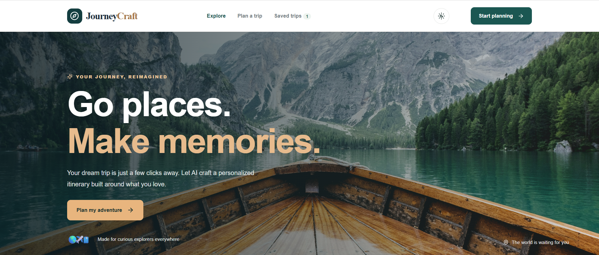
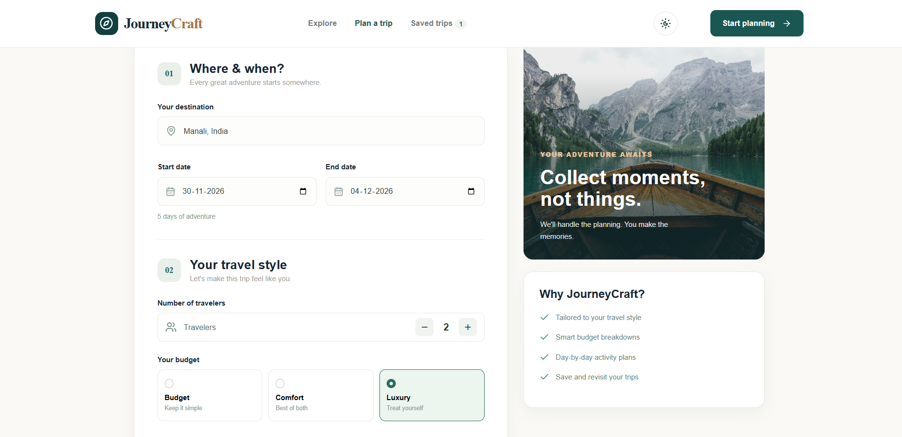

# 🌍 JourneyCraft — Smart Travel Itinerary Generator

A modern, responsive travel planning web application built with **React.js, JavaScript, Node.js, Express.js, and CSS**. JourneyCraft helps users create personalized day-by-day travel itineraries based on their destination, budget, travel dates, and interests, with optional AI-powered trip generation.

## ✨ Key Features

- 🗺️ **Personalized Trip Planning** — Generate itineraries based on destination, dates, budget, and travel preferences.
- 📅 **Interactive Itineraries** — Explore day-wise activities, timings, and editable travel plans.
- 💰 **Budget Estimation** — View estimated expenses for accommodation, food, transport, and activities.
- 🤖 **Optional AI Integration** — Generate AI-powered itineraries using the OpenAI API, with sample plans as a fallback.
- 💾 **Save & Manage Trips** — Save, revisit, and delete itineraries using localStorage.
- 🎨 **Responsive UI & Dark Mode** — Seamless experience across desktop and mobile devices.

## 🛠️ Tech Stack

**Frontend:** React.js, JavaScript (ES6+), HTML5, CSS3

**Backend:** Node.js, Express.js, REST API

**Tools & Integration:** Vite, OpenAI API (Optional), Google Maps Search, localStorage, Vercel


## 📸 Project Screenshots

### Homepage


### Landingpage Locations


### Trip Planner


### Generated Itinerary


## ⚙️ Getting Started

**1. Clone the repository**

```bash
git clone https://github.com/Rithik-joshi/JourneyCraft-ai-travel-planner.git
cd JourneyCraft-ai-travel-planner
```

**2. Install dependencies**

```bash
npm install
```

**3. Run the application**

```bash
npm run dev
```

Open `http://localhost:5173` in your browser.

For optional AI generation, configure `OPENAI_API_KEY` in a local `.env` file using `.env.example`. Without an API key, the application uses sample itineraries.

## 🚀 Live Demo

**Live Website:** Coming Soon

## 👨‍💻 Developer

**GitHub:** https://github.com/YOUR_USERNAME

---

⭐ If you like this project, consider giving it a star!