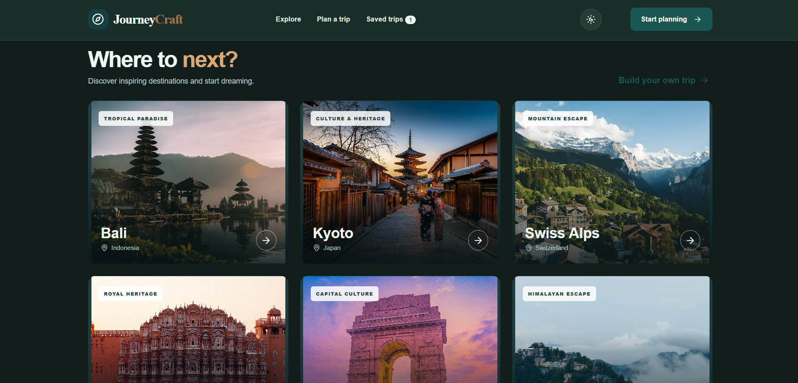
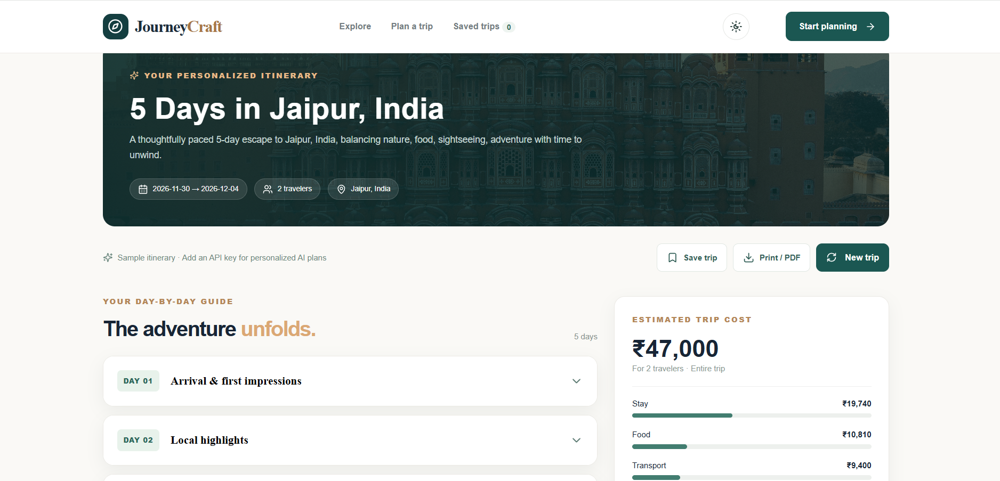

# 🌍 JourneyCraft — Smart Travel Itinerary Generator

**Plan Smarter. Travel Better. Explore More.**

JourneyCraft is a modern, responsive travel planning web application that helps users create personalized, day-by-day travel itineraries based on their destination, travel dates, budget, and interests.

Built using **React.js, JavaScript, Node.js, Express.js, and CSS3**, JourneyCraft offers an interactive travel planning experience with itinerary management, budget estimation, dark mode, and optional AI-powered trip generation.

### 🔗 Project Links

🌐 **Live Demo:** [Explore JourneyCraft](https://journeycraft-theta.vercel.app/)

💻 **GitHub Repository:** [View Source Code](https://github.com/Rithik-joshi/JourneyCraft-ai-travel-planner)

---

## ✨ Key Features

- 🗺️ **Personalized Trip Planning** — Create travel itineraries based on destination, dates, budget, and personal preferences.
- 📅 **Day-Wise Itinerary Generation** — Explore organized daily travel plans with activities, schedules, and destinations.
- 💰 **Budget Estimation** — View estimated travel expenses for accommodation, transportation, food, and activities.
- 🤖 **Optional AI-Powered Planning** — Generate travel recommendations using OpenAI API integration, with sample itineraries as a fallback.
- 💾 **Save & Manage Trips** — Save, revisit, and delete travel itineraries using browser localStorage.
- 🌙 **Dark Mode Support** — Switch between light and dark themes for a comfortable viewing experience.
- 📱 **Responsive Design** — Optimized for desktops, tablets, and mobile devices.
- 🎨 **Modern User Interface** — Clean layouts, intuitive navigation, and interactive components.

---

## 🛠️ Tech Stack

| Category | Technologies |
|---|---|
| Frontend | React.js, JavaScript (ES6+), HTML5, CSS3 |
| Backend | Node.js, Express.js |
| API | REST API, OpenAI API (Optional) |
| Build Tool | Vite |
| Data Storage | Browser localStorage |
| Additional Integration | Google Maps Search |
| Deployment | Vercel |
| Version Control | Git, GitHub |

---

## 📸 Project Screenshots

### 🏠 Homepage


### 🌍 Explore Destinations



### 🗺️ Trip Planner


### 📅 Generated Itinerary



---

## ⚙️ Getting Started

Follow these instructions to run JourneyCraft locally on your computer.

### Prerequisites

Make sure you have installed:

- Node.js
- npm
- Git

### 1. Clone the Repository

```bash
git clone https://github.com/Rithik-joshi/JourneyCraft-ai-travel-planner.git
```

### 2. Navigate to the Project Directory

```bash
cd JourneyCraft-ai-travel-planner
```

### 3. Install Dependencies

```bash
npm install
```

### 4. Start the Development Server

```bash
npm run dev
```

Open the local URL displayed in your terminal, typically:

`http://localhost:5173`

### 5. Optional AI Configuration

To enable AI-powered itinerary generation, configure the required environment variables using the provided `.env.example` file.

```env
OPENAI_API_KEY=your_openai_api_key
```

**Note:** Keep API keys secure and never commit your `.env` file to GitHub. AI API requests should be handled securely through the backend rather than exposing secret keys in frontend code.

Without AI configuration, the application can use its sample itinerary functionality.

---

## 🚀 Live Demo

JourneyCraft is deployed on **Vercel** and can be accessed through the link below.

### 🌐 [Visit JourneyCraft — Live Website](https://journeycraft-theta.vercel.app/)

Explore the application, generate travel plans, manage saved itineraries, and experience its responsive interface.

---

## 🔮 Future Enhancements

- User authentication and personalized accounts.
- Cloud database integration for storing travel plans.
- Real-time weather forecasts for travel destinations.
- Interactive maps and route optimization.
- Improved AI-powered travel recommendations.
- Travel expense tracking and budget analytics.

---

## 👨‍💻 Developer

**Rithik Joshi**

Software Developer | React.js & JavaScript Enthusiast

- 💻 **GitHub:** [Rithik-joshi](https://github.com/Rithik-joshi)
- 🔗 **LinkedIn:** [rithikjoshi27](https://www.linkedin.com/in/rithikjoshi27/)
- 🌐 **Live Project:** [JourneyCraft](https://journeycraft-theta.vercel.app/)

---

## ⭐ Support

If you find JourneyCraft useful or interesting, consider giving this repository a ⭐ star!

**Made with ❤️ using React.js and JavaScript.**

## 👨‍💻 Developer

**GitHub:** https://github.com/Rithik-joshi

---

⭐ If you like this project, consider giving it a star!
